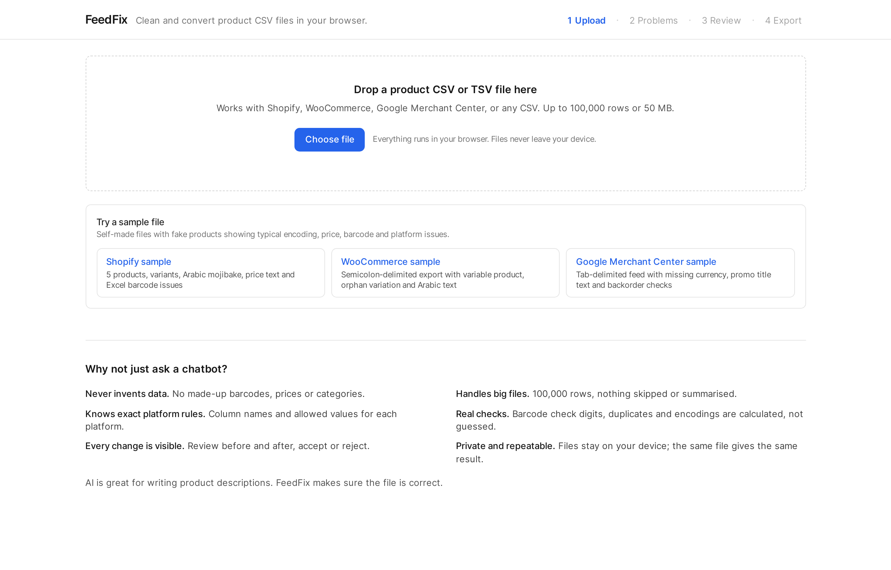
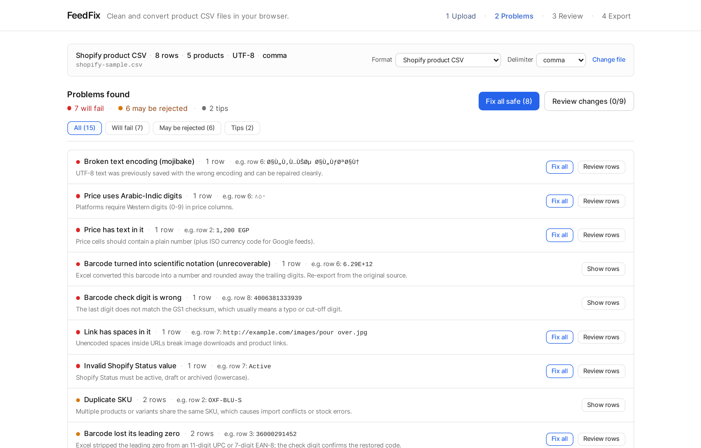
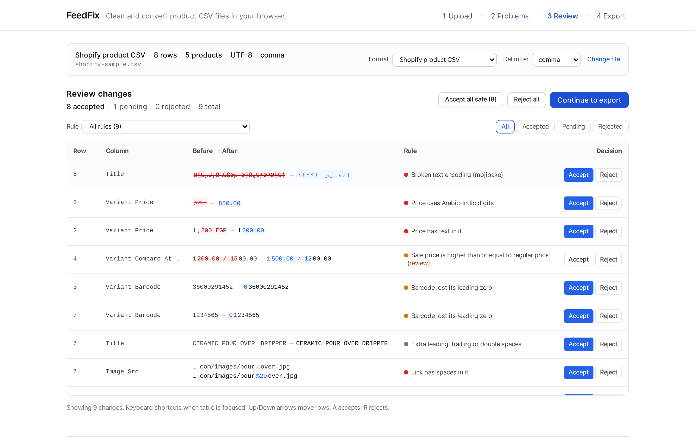
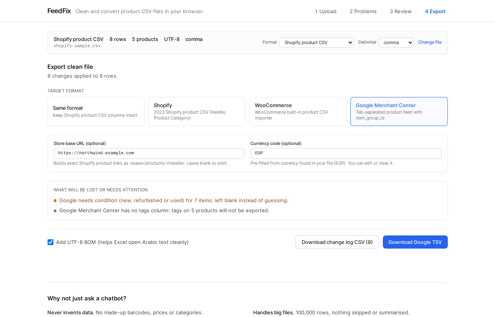

# FeedFix

FeedFix is a free, browser-based tool that finds and fixes problems in product CSV files from **Shopify, WooCommerce and Google Merchant Center** and converts catalogs between them. Every fix is deterministic, reviewed before export, and recorded in a downloadable change log — with zero server uploads.

## Screenshots

| Upload & sample feeds                       | Grouped problems overview                           |
| ------------------------------------------- | --------------------------------------------------- |
|  |  |

| Virtualized review table                     | Conversion & export                          |
| -------------------------------------------- | -------------------------------------------- |
|  |  |

## Supported platforms

- **Shopify product CSV:** groups variant and extra image rows by `Handle`, supports `Product Category` (and legacy `Standardized Product Type`), `Option1`–`Option3` (`Title` / `Default Title` for single-variant items), `Variant Price` / `Variant Compare At Price`, `Variant Barcode`, `Variant Inventory Qty` (single-location caveat), `Variant Inventory Policy`, `Variant Fulfillment Service`, and `Status`.
- **WooCommerce product CSV (built-in importer):** handles `simple`, `variable`, `variation`, `grouped`, and `external` types (with comma modifiers such as `virtual`), `Parent` references by SKU or `id:<ID>`, `Published` (`1` / `0` / `-1` / `2`), `In stock?` (`1` / `0` / `backorder`), `Weight (kg|g|lbs|oz)`, `Attribute N name/value(s)`, and optional read aliases for common barcode/brand plugin columns (`Meta: _gtin`, `Meta: _wpm_gtin_code`, `Attribute: Brand`). Because WooCommerce core has no native barcode or brand column, exports to WooCommerce omit them and note this clearly in the conversion report.
- **Google Merchant Center feed (CSV/TSV):** supports `item_group_id`, exact `availability` values (`in_stock`, `out_of_stock`, `preorder`, `backorder`) with required `availability_date` for `preorder`/`backorder`, `price` / `sale_price` with ISO-4217 currency codes, `gtin` / `mpn` / `identifier_exists`, `condition`, length limits, and lazy-loaded validation against the official Google Product Taxonomy (`2021-09-21`).
- **Other CSV:** manual column mapping to the unified product model with reusable presets saved locally in `localStorage`.

## Common problems FeedFix catches

| What goes wrong                           | Why it happens                                                     | What FeedFix does                                                                  |
| ----------------------------------------- | ------------------------------------------------------------------ | ---------------------------------------------------------------------------------- |
| Arabic text turns into `ال...` or `???` | Saved by Excel in Windows-1256 / mis-decoded UTF-8 (or lossy save) | Detects encoding, repairs mojibake, flags `???` as unrecoverable, exports UTF-8    |
| Import reads everything as one column     | Excel in Arabic/European locales saves with `;`                    | Detects comma, semicolon, tab, and pipe delimiters                                 |
| Barcodes become `6.29E+12`                | Excel rounded them as numbers                                      | Flags as unrecoverable and explains why digits are lost                            |
| UPCs / EAN-8s lose their leading zero     | Excel number formatting                                            | Restores 11→12-digit UPCs and 7→8-digit EAN-8s only when GS1 check digit proves it |
| `1,200 EGP`, `٨٥٠`, `49,90` in prices     | Human-typed prices                                                 | Normalizes to `1200.00` using decimal-safe math (+ ISO currency for Google)        |
| Sale price higher than regular price      | Columns swapped                                                    | Flags it and offers an opt-in swap                                                 |
| Duplicate SKUs, IDs or split handles      | Copy-paste or unsorted rows                                        | Lists every duplicate group                                                        |
| Google rejects items                      | Missing `brand`/`gtin`, wrong `availability`, promo text in titles | Platform checks with exact allowed values                                          |
| Moving stores (Woo ↔ Shopify ↔ Google)    | Different columns and variant models                               | Converts via one product model and reports what is missing or omitted              |

## Why not just ask a chatbot?

- **Never invents data.** No made-up barcodes, prices or categories.
- **Handles big files.** 100,000 rows, nothing skipped or summarised.
- **Knows exact platform rules.** Column names and allowed values for each platform.
- **Real checks.** Barcode check digits, duplicates and encodings are calculated, not guessed.
- **Every change is visible.** Review before and after, accept or reject.
- **Private and repeatable.** Files stay on your device; the same file gives the same result.

AI is great for writing product descriptions. FeedFix makes sure the file is correct.

## Rules

| Group    | Checks                                                                                                                                                                       | Safe auto-fix                                              |
| -------- | ---------------------------------------------------------------------------------------------------------------------------------------------------------------------------- | ---------------------------------------------------------- |
| File     | Encoding (UTF-8, UTF-16, Windows-1256/1252), mojibake, unrecoverable `???`, delimiter, duplicate/empty headers, ragged rows, invisible chars (zero-width, NBSP, BOM)         | Re-decode, repair mojibake, strip invisible chars          |
| Required | Required columns and values per platform, Shopify variant defaults, Google `availability_date` for `preorder`/`backorder`, `identifier_exists` logic                         | Reports missing/conflicting values                         |
| Identity | Duplicate SKU, duplicate ID, split Shopify handles, empty variant SKUs                                                                                                       | Reports duplicate groups                                   |
| Price    | Arabic-Indic digits, text/currency in number, decimal comma, invalid/negative/zero, missing Google currency, sale ≥ regular                                                  | Format normalization only; sale ≥ regular is opt-in review |
| Barcode  | Length 8/12/13/14, GS1 check digit, scientific notation (unrecoverable), lost leading zero (11→12, 7→8 only), all-same digits                                                | Leading zero restore when check digit proves it            |
| Text     | HTML in titles, ALL CAPS titles, platform length limits, promotional phrases in Google titles, leading/trailing/double spaces                                                | Trim/collapse whitespace only                              |
| Links    | Relative/broken URLs (`fail`), `http://` URLs (`tip`, never rewritten), spaces in URLs, missing product images                                                               | Percent-encode spaces only                                 |
| Variants | Missing Shopify option values, orphan rows, >3 options / >100 variants (Shopify), orphan WooCommerce variations, missing Google `item_group_id`                              | Reports structural issues                                  |
| Values   | Exact allowed enum values for `availability`, `condition`, `identifier_exists`, Shopify `Status`/`Published`/`Variant Inventory Policy`, WooCommerce `Published`/`In stock?` | Safe mapping to canonical values                           |
| Category | Google `google_product_category` numeric IDs and full paths against the official `2021-09-21` taxonomy (lazy-loaded)                                                         | Reports unknown categories                                 |

## Privacy

Everything runs locally in your browser: CSV decoding, parsing, and rule checks execute inside a Web Worker, Inter fonts are self-hosted in the bundle, and no product data is ever sent to any server. Column-mapping presets are stored only in your browser's `localStorage`.

## Run locally

Requires **Node.js 24 LTS** (or Docker with `node:24`).

```bash
npm install
npm run dev
```

Run checks and tests:

```bash
npm run lint
npm test
npm run build
npm run test:e2e
```

## Deploy

FeedFix is a static site with no backend. Build the production bundle and deploy `dist/` to Cloudflare Pages, Netlify, or any static host:

```bash
npm run build
```

## Limits

- Up to **100,000 rows** or **50 MB** per file in the browser.
- CSV and TSV text files only (no `.xlsx` spreadsheets).
- Does not fetch remote image URLs to check whether images load (browsers block cross-origin requests to store hosts without a server).
- "Same format" export preserves all extra columns from your original file; cross-platform conversions map through the shared product model and list any omitted or missing fields before download.

## License

[MIT](LICENSE)
